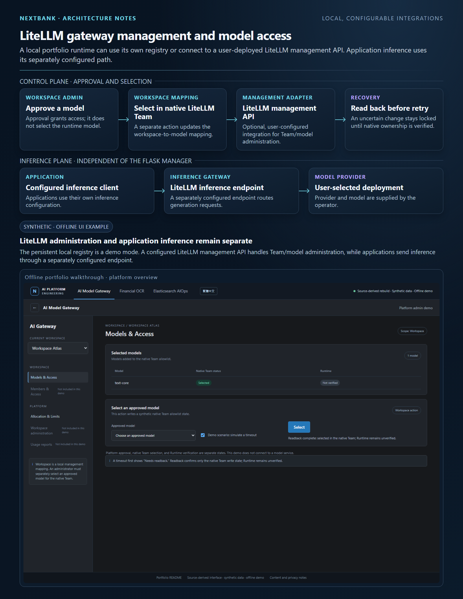
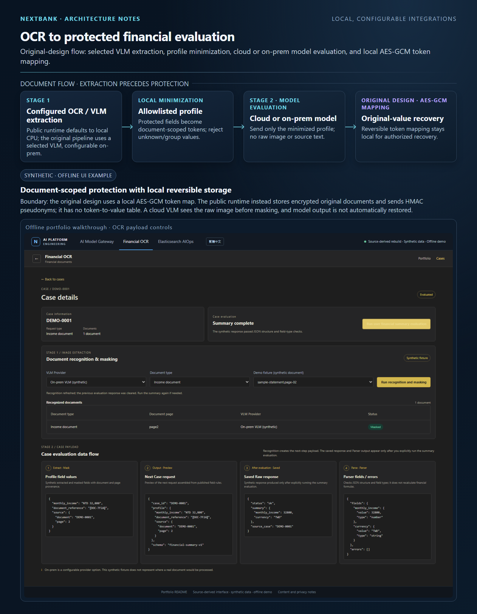
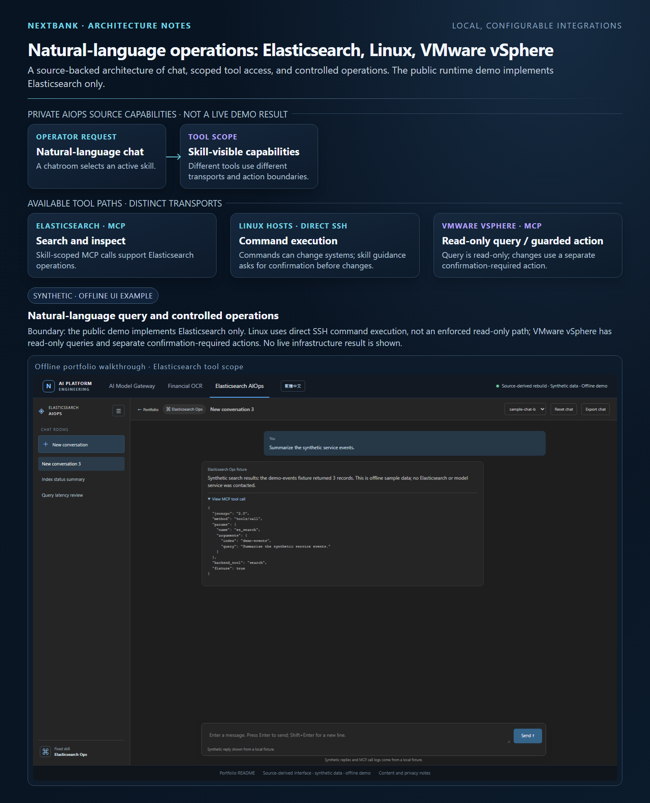

# AI Model Gateway - Engineering Portfolio

This project is the LiteLLM management proxy and control layer for a separately deployed LiteLLM Gateway; operators deploy LiteLLM themselves for the actual model gateway and inference. It manages native LiteLLM objects and does not forward inference requests. The optional local SQLite workflow demonstrates management behavior and is not a substitute for LiteLLM. Financial OCR and Elasticsearch AIOps are application examples with separately configured inference endpoints. This portfolio presents selected designs and synthetic examples drawn from real engineering work.

[Open the local portfolio](index.html) | [Run the local app](app.en.html) | [Gateway offline walkthrough](demo.en.html?module=gateway) | [OCR offline walkthrough](demo.en.html?module=ocr) | [Elasticsearch chat offline walkthrough](demo.en.html?module=chat) | [Traditional Chinese runtime](app.html) | [Read in Traditional Chinese](README.zh-TW.md)

## Three engineering areas

### 1. AI Gateway — LiteLLM management



Workspace model governance separates approval, native LiteLLM Team selection, and operation readback. This composite pairs source-derived architecture with the existing offline synthetic UI; it is not a live runtime capture. [Read the Gateway case study](case-studies/model-gateway.md).

### 2. AI OCR / Financial OCR — local privacy controls and optional cloud computation



The original design kept a reversible encrypted token mapping locally, with case-authorized and audited reversal. The public runtime instead encrypts original document records with AES-GCM for local recovery and uses HMAC pseudonyms for outbound fields; it does not store a token-to-value mapping table, and model output is never automatically detokenized. Recognition runs locally by default; a minimized profile is sent only when an external evaluation endpoint is configured. If VLM is selected, the original image is sent to the configured vision endpoint before any de-identification; details are below. This composite pairs source-derived architecture with the existing offline synthetic UI; it is not a live runtime capture. [Read the OCR case study](case-studies/financial-ocr.md).

### 3. AIOps — natural-language operations



The original application supported natural-language operational workflows using skill-scoped MCP tools for Elasticsearch, SSH for Linux, and MCP for VMware vSphere; VMware changes require explicit confirmation and service authorization. The public runtime currently exposes Elasticsearch search only. This composite pairs source-derived architecture with the existing offline synthetic UI; it is not a live runtime capture. [Read the AIOps case study](case-studies/operations-chatroom.md).

## What this checkout can run

| Part | Available here |
| --- | --- |
| Local live app | `public_app` is a runnable Flask service with SQLite persistence, Gateway workspace/model approval and selection workflows, operation readback, local event search, chat rooms, and actual OCR processing. It is a public reconstruction and does not include the original private application services. |
| Offline walkthrough | The source-derived `demo*.html` pages use deterministic synthetic browser state. They do not call the Flask app, run models, read files, or query Elasticsearch; this state resets on reload. |
| Python examples | Separate runnable sample logic for idempotency/readback, AES-GCM token mapping/profile filtering, and MCP visibility/dispatch. These examples use in-memory records and fake providers. |
| Optional external services | LiteLLM management, model inference, VLM, and Elasticsearch run only when the operator supplies their own endpoint configuration. The runtime has no bundled model or Elasticsearch service. The private source checkout's deployment artifacts and complete tracked CI/CD pipeline are not part of this public checkout. |

Live app records persist in the local SQLite database under `.local/runtime`; its browser view state resets on reload. Offline walkthrough state resets on reload, and the separate Python example's operation, provider, and pseudonym records exist only in that process. None of these public tools connects to a private platform deployment.


## Run the local application

The live app requires Python 3.11 or later; this checkout was verified with Python 3.14.5. From the portfolio folder, create an isolated environment, install the runtime dependencies, and start the loopback-only server. It uses local SQLite and local OCR by default; external integrations are optional and user-configured. The Connections page accepts endpoint URLs and model names only. Keep model and LiteLLM credentials in the ignored `.local/runtime-config.json` or environment variables. Elasticsearch requests support a directly reachable test endpoint without credentials; authenticated Elasticsearch is not configured by this runtime.

**Windows PowerShell:**

```powershell
py -3 -m venv .venv
.venv\Scripts\python.exe -m pip install -r requirements-runtime.txt
.venv\Scripts\python.exe -m public_app
```

**macOS / Linux:**

```console
python3 -m venv .venv
.venv/bin/python -m pip install -r requirements-runtime.txt
.venv/bin/python -m public_app
```

Open <http://127.0.0.1:8000/>. The local operator console has no authentication; keep the server bound to loopback and do not expose its port to a network. The app does not contain a bundled inference model or Elasticsearch service.

RapidOCR runs on the local CPU by default. Selecting VLM requires an explicit confirmation: the original, unmodified uploaded image is sent to the vision endpoint configured by the operator, and it is not de-identified before the VLM receives it. LLM evaluation sends a minimized profile containing only allowlisted fields; name and account values are replaced with document-scoped tokens, raw image/OCR text and source identifiers are excluded, and provenance contains field names only. Local validation checks fields and types, not financial formulas or eligibility. See [live runtime details](docs/public-runtime.md) for the exact boundaries. Chat search uses local SQLite FTS5 unless Elasticsearch is configured. The public `/mcp` route is a scoped JSON-RPC tool-call subset, not a general-purpose MCP client/server implementation.

## Offline walkthrough

Open `index.html` or a module link above directly in a browser for the static portfolio and offline walkthrough. These pages remain usable without Python but do not connect to the live app. To serve the files over HTTP, run this command from the portfolio folder:

```console
python -m http.server 8000 --bind 127.0.0.1
```

Then open <http://127.0.0.1:8000/index.html> for the static portfolio. GitHub renders HTML as source and does not host this live app. Offline browser controls use synthetic fixtures only; no local documents or external services are accessed.

## Case studies

| Case | Engineering question | What the case explains |
| --- | --- | --- |
| [AI Model Gateway](case-studies/model-gateway.md) | How can model access and shared platform objects be governed without making the manager an inference proxy? | Flask management plane, native LiteLLM objects, separate management and inference paths, approval/readback states, and boundaries. |
| [Financial OCR](case-studies/financial-ocr.md) | How can document processing minimize downstream exposure while preserving provenance? | Image based first stage, reversible PII pseudonyms, profile allowlisting, minimized case payload, and response schema checks. |
| [Elasticsearch AIOps](case-studies/operations-chatroom.md) | How can a chat workflow offer useful search tools while keeping its real authorization boundary clear? | Skill-scoped model-visible tools, JSON-RPC MCP, query guidance, original dispatch limitations, and public-sample hardening. |

The Gateway is the platform case. OCR and Elasticsearch chat are applications around it; their inference calls are configured independently from the Gateway manager.

## Reproducible public sample

The commands below require an installed Python 3.14 interpreter; verification used Python 3.14.5. Create an isolated environment from the portfolio folder. These commands do not require activating it.

**Windows PowerShell:**

```powershell
py -3.14 -m venv .venv
.venv\Scripts\python.exe examples/run_demo.py gateway
.venv\Scripts\python.exe examples/run_demo.py mcp
```

**macOS / Linux:**

```console
python3.14 -m venv .venv
.venv/bin/python examples/run_demo.py gateway
.venv/bin/python examples/run_demo.py mcp
```

Gateway and MCP use only the Python standard library. OCR, the combined `all` command, and the checks need `cryptography` for AES-GCM token mapping. Install it in the isolated environment before those commands:

```console
.venv/bin/python -m pip install -r requirements-demo.txt
.venv/bin/python examples/run_demo.py ocr
.venv/bin/python examples/run_demo.py all
.venv/bin/python -m unittest discover -s tests -p "test_examples.py" -v
```

On Windows, replace `.venv/bin/python` in this block with `.venv\Scripts\python.exe`. The public Python sample uses safer defaults where the original chat application had a known gap: it rejects unknown skills and checks dispatch against the selected skill. This sample improvement does not describe the original application. See [implementation notes](docs/public-sample.md) for commands and scope.

## Diagrams and notices

The [platform overview](assets/diagrams/platform-overview.html) separates Gateway administration from application inference. Additional diagrams cover [Gateway recovery](assets/diagrams/gateway-recovery.html), [OCR](assets/diagrams/financial-ocr.html), and [Elasticsearch MCP](assets/diagrams/elasticsearch-mcp.html). Each is an explanatory model, not a deployment screenshot.

The diagrams use [Archify](https://github.com/tt-a1i/archify), included under its MIT license at [third_party/ARCHIFY_LICENSE](third_party/ARCHIFY_LICENSE). See [third-party notices](THIRD_PARTY_NOTICES.md).

## Delivery and ownership

I led the project end to end across product design, application code, platform governance, deployment, and CI/CD work. The private original project included deployment artifacts. This public checkout contains a runnable local Flask/SQLite reconstruction, but excludes the private backend services, container or Helm artifacts, and a complete tracked delivery pipeline. The live app, offline walkthrough, and Python samples are the public runnable deliverables; this portfolio does not claim a particular live deployment state or production outcome.

## Scope

Internal configuration and real operational or document data are excluded or replaced with generic synthetic examples. Synthetic records and metrics are labeled. No private source repository is copied into this portfolio. See [CONTENT_SELECTION.md](CONTENT_SELECTION.md) for selection rules and known limits.
