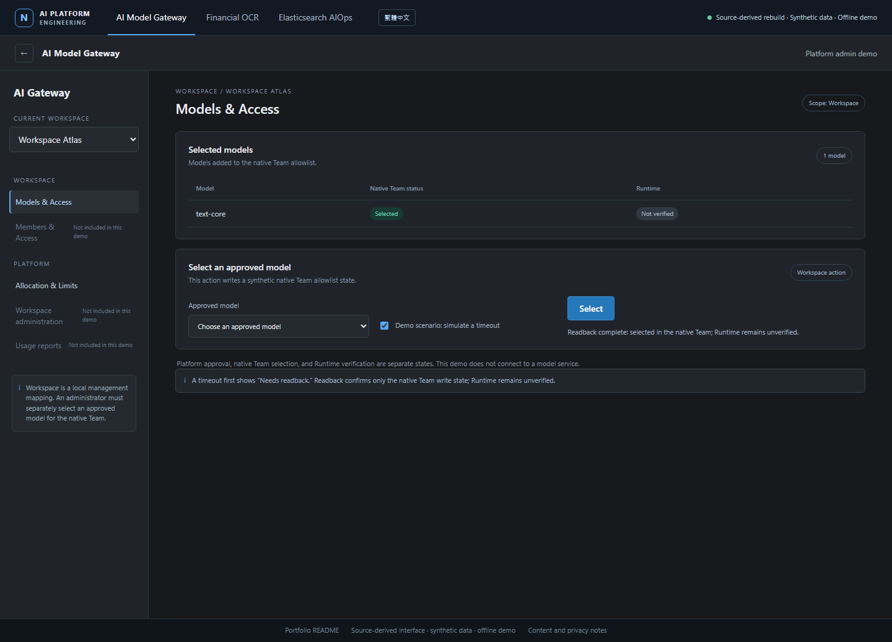

# AI Model Gateway — Engineering Portfolio

An AI Model Gateway provides a control plane for model endpoints, workspace access, and shared usage. Its engineering problems include governing Workspace and model access, separating approval from native Team configuration, and reconciling remote writes whose outcomes are uncertain. The Gateway manages native LiteLLM objects; Financial OCR and Elasticsearch AIOps are application examples with separately configured inference endpoints. This portfolio presents selected designs and synthetic examples drawn from real engineering work.

[Open the local portfolio](index.html) · [Gateway walkthrough](demo.en.html?module=gateway) · [OCR walkthrough](demo.en.html?module=ocr) · [Elasticsearch chat walkthrough](demo.en.html?module=chat) · [繁體中文示例](demo.html?module=gateway) · [Read in Traditional Chinese](README.zh-TW.md)


### Local walkthrough previews

[](demo.en.html?module=gateway)

[Financial OCR preview](demo.en.html?module=ocr) · [Elasticsearch AIOps preview](demo.en.html?module=chat)

## Local walkthrough

Open `index.html` or a module link above in a browser, or serve the folder with any static HTTP server. There is no build step, external font, or network dependency. The operational UI is reconstructed from source templates and populated with synthetic records; browser actions use deterministic local fixtures and do not call a backend, model, LiteLLM, Elasticsearch, OCR provider, or local document.

## Case studies

| Case | Engineering question | What the case explains |
| --- | --- | --- |
| [AI Model Gateway](case-studies/model-gateway.md) | How can model access and shared platform objects be governed without making the manager an inference proxy? | Flask management plane, native LiteLLM objects, separate management and inference paths, approval/readback states, and boundaries. |
| [Financial OCR](case-studies/financial-ocr.md) | How can document processing minimize downstream exposure while preserving provenance? | Image based first stage, reversible PII pseudonyms, profile allowlisting, minimized case payload, and response schema checks. |
| [Elasticsearch AIOps](case-studies/operations-chatroom.md) | How can a chat workflow offer useful search tools while keeping its real authorization boundary clear? | Skill-scoped model-visible tools, JSON-RPC MCP, query guidance, original dispatch limitations, and public-sample hardening. |

The Gateway is the platform case. OCR and Elasticsearch chat are applications around it; their inference calls are configured independently from the Gateway manager.

## Reproducible public sample

The Python examples use generated records and local fixtures. OCR's AES-GCM token mapping and the combined `all` command require `cryptography`; Gateway and MCP can run without it. Install the optional sample dependency before running OCR or all examples:

```console
python -m pip install -r requirements-demo.txt
python examples/run_demo.py all
```

The public Python sample uses safer defaults where the original chat application had a known gap: it rejects unknown skills and checks dispatch against the selected skill. This is a sample improvement, not a claim about the original application. See [implementation notes](docs/public-sample.md) for commands and scope.

## Diagrams and notices

The [platform overview](assets/diagrams/platform-overview.html) separates Gateway administration from application inference. Additional diagrams cover [Gateway recovery](assets/diagrams/gateway-recovery.html), [OCR](assets/diagrams/financial-ocr.html), and [Elasticsearch MCP](assets/diagrams/elasticsearch-mcp.html). Each is an explanatory model, not a deployment screenshot.

The diagrams use [Archify](https://github.com/tt-a1i/archify), included under its MIT license at [third_party/ARCHIFY_LICENSE](third_party/ARCHIFY_LICENSE). See [third-party notices](THIRD_PARTY_NOTICES.md).

## Delivery and ownership

I led the project end to end across product design, application code, platform governance, deployment, and CI/CD work. The delivery note distinguishes that contribution from what can be checked in this source snapshot: deployment artifacts are present, while a complete tracked delivery pipeline is not included. This portfolio does not claim a particular live deployment state or production outcome.

## Scope

Internal configuration and real operational or document data are excluded or replaced with generic synthetic examples. Synthetic records and metrics are labeled. No private source repository is copied into this portfolio. See [CONTENT_SELECTION.md](CONTENT_SELECTION.md) for selection rules and known limits.
