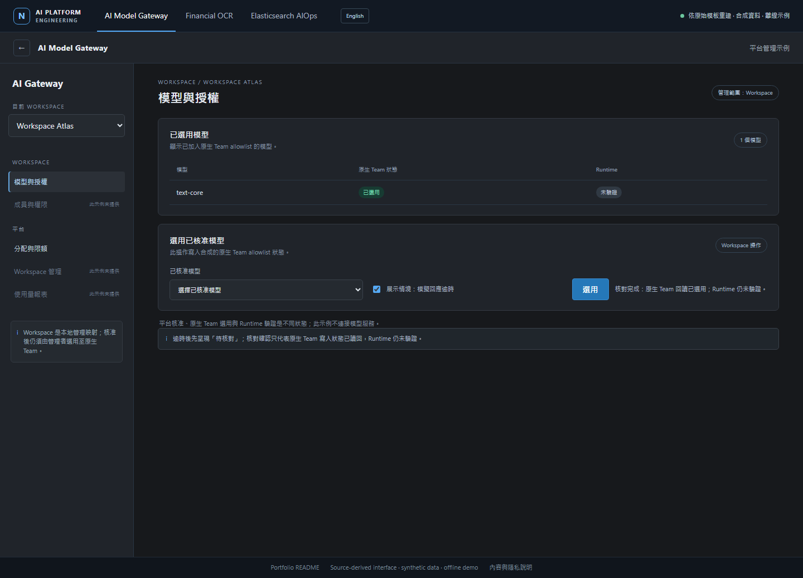

# AI Model Gateway 工程作品集

AI Model Gateway 是管理模型端點、Workspace 存取與共用用量的控制面。工程重點包括管理 Workspace 與模型權限、區分核准和原生 Team 設定，以及處理遠端寫入結果不明時的讀回核對。Gateway 管理 LiteLLM 原生物件；Financial OCR 與 Elasticsearch AIOps 是各自使用獨立推論端點的應用示例。本作品集呈現源自實際工程工作的設計與合成示例。

[開啟本機作品集](index.html) · [Gateway 操作示例](demo.html?module=gateway) · [OCR 操作示例](demo.html?module=ocr) · [Elasticsearch 對話示例](demo.html?module=chat) · [English Gateway demo](demo.en.html?module=gateway) · [English OCR demo](demo.en.html?module=ocr) · [English chat demo](demo.en.html?module=chat) · [English README](README.md)


### 本機示例預覽

[](demo.html?module=gateway)

[Financial OCR 預覽](demo.html?module=ocr) · [Elasticsearch AIOps 預覽](demo.html?module=chat)

## 本機操作示例

在瀏覽器開啟 `index.html` 或上方模組連結，也可用任意靜態 HTTP server 提供此資料夾。無需建置步驟、外部字型或網路連線。操作介面依來源模板重建，內容使用合成紀錄；瀏覽器互動使用固定本機 fixture，不會呼叫後端、模型、LiteLLM、Elasticsearch、OCR provider，也不會讀取本機文件。

## 案例研究

| 案例 | 工程問題 | 案例內容 |
| --- | --- | --- |
| [AI Model Gateway](case-studies/model-gateway.md) | 如何治理模型存取與平台物件，同時維持管理面和推論流量分離？ | Flask 管理控制面、LiteLLM 原生物件、獨立推論路徑、核准與讀回狀態，以及系統邊界。 |
| [Financial OCR](case-studies/financial-ocr.md) | 如何降低文件處理的下游資料暴露並保留來源資訊？ | 圖片辨識第一階段、可還原個資假名、Profile 欄位白名單、精簡案例 payload 與回應 schema 檢查。 |
| [Elasticsearch AIOps](case-studies/operations-chatroom.md) | 對話流程如何提供搜尋工具並清楚呈現實際授權邊界？ | 技能範圍內的模型可見工具、JSON-RPC MCP、查詢限制、原系統 dispatch 限制及公開示例的加強措施。 |

Gateway 是平台案例；OCR 與 Elasticsearch 對話是周邊應用，其推論端點各自配置，不經 Gateway 管理服務轉送。

## 可重現公開示例

Python 範例使用產生的紀錄與本機 fixture。Gateway 與 MCP 可直接執行。OCR 的 AES-GCM 假名範例與整合指令 `all` 需要 `cryptography`；若要執行 OCR 或全部範例，請先安裝：

```console
python -m pip install -r requirements-demo.txt
python examples/run_demo.py all
```

原聊天應用有已知的工具授權缺口；公開 Python sample 使用較安全的預設值，拒絕未知技能並依所選技能檢查工具 dispatch。這是公開示例新增的改善，不代表原系統原有此項控制。請參閱[公開示例說明](docs/public-sample.md)了解指令與範圍。

## 架構圖與授權聲明

[平台總覽圖](assets/diagrams/platform-overview.html)呈現 Gateway 管理與應用推論路徑的區別；其他圖包含 [Gateway 復原流程](assets/diagrams/gateway-recovery.html)、[OCR](assets/diagrams/financial-ocr.html)及 [Elasticsearch MCP](assets/diagrams/elasticsearch-mcp.html)。架構圖用於解說，不是部署畫面截圖。

架構圖使用 [Archify](https://github.com/tt-a1i/archify)，並保留其 MIT 授權全文於 [third_party/ARCHIFY_LICENSE](third_party/ARCHIFY_LICENSE)。其他資訊請見[第三方授權聲明](THIRD_PARTY_NOTICES.md)。

## 交付與負責範圍

我端到端負責 AI Model Gateway 與其應用範圍，工作涵蓋產品設計、應用程式實作、平台治理、部署與 CI/CD。交付說明會區分個人負責的工作和本來源快照中可檢視的內容：快照包含部署相關成果，但未包含完整追蹤的交付 pipeline。本作品集不宣稱特定的即時部署狀態或正式環境成效。

## 範圍

內部設定與真實營運或文件資料均已排除，或以通用合成示例取代；合成紀錄與指標會清楚標示。本作品集不複製私有原始碼庫。選材原則與已知限制請見 [CONTENT_SELECTION.md](CONTENT_SELECTION.md)。
